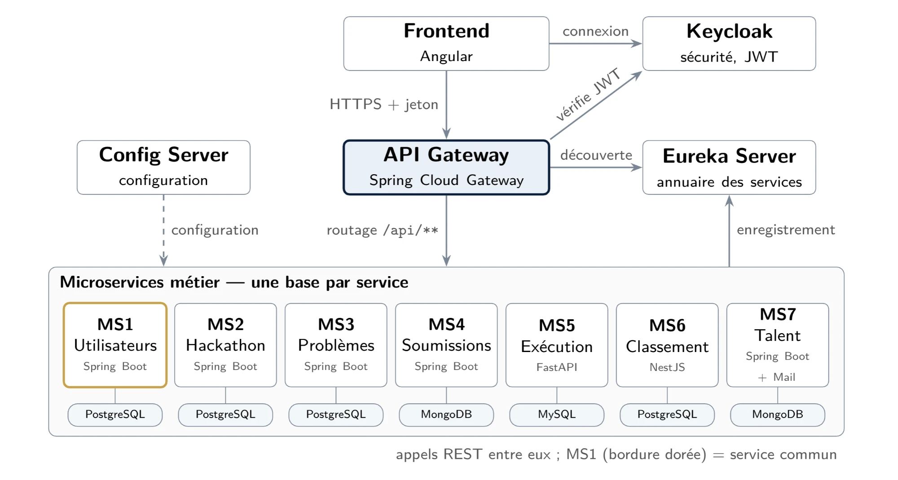

# ChallengeHub(Had maymess khedmet lekhir )

Plateforme de hackathons avec évaluation automatique du code et recrutement des meilleurs développeurs.

Module AWD (Applications Web Distribuées) · ESPRIT · année universitaire 2026-2027

---

## Table des matières

1. [Présentation](#présentation)
2. [Architecture](#architecture)
3. [Microservices](#microservices)
4. [Structure du dépôt](#structure-du-dépôt)
5. [Documentation](#documentation)
6. [Avancement](#avancement)
7. [Démarrage](#démarrage)
8. [Équipe](#équipe)
9. [Contribuer](#contribuer)

## Présentation

Une entreprise publie ses problèmes techniques réels sous forme de défis de hackathon. Les participants proposent des solutions en Python ou en Java, que la plateforme exécute et note automatiquement. L'entreprise récupère les meilleures solutions et recrute les développeurs les mieux classés.

| Microservices | Frameworks back-end | Types de bases de données | Langages évalués |
| :---: | :---: | :---: | :---: |
| 7 | 3 | 3 | 2 |

**État actuel :** la conception et la modélisation (Validation 1) sont terminées et documentées. L'arborescence des microservices est créée ; le code reste à implémenter.

## Architecture

Le frontend Angular communique uniquement avec l'API Gateway. Celle-ci vérifie le jeton JWT émis par Keycloak, localise le service cible grâce à Eureka et route les requêtes `/api/**`. Les services lisent leur configuration auprès du Config Server et communiquent entre eux en REST. Chaque service dispose de sa propre base de données.

## Microservices

| Service | Responsabilité | Technologie | Base de données |
| :--- | :--- | :--- | :--- |
| [MS1 Utilisateurs](backend/ms1-utilisateurs/) (commun) | Comptes, profils, rôles, intégration Keycloak | Spring Boot 3 | PostgreSQL |
| [MS2 Hackathon](backend/ms2-hackathon/) | Hackathons, équipes, invitations, inscriptions | Spring Boot 3 | PostgreSQL |
| [MS3 Problèmes](backend/ms3-problemes/) | Énoncés, tests publics et cachés, limites, points | Spring Boot 3 | PostgreSQL |
| [MS4 Soumissions](backend/ms4-soumissions/) | Enregistrement, éligibilité, meilleures solutions | Spring Boot 3 | MongoDB |
| [MS5 Exécution](backend/ms5-execution/) | Exécution isolée du code, verdict par test | Python, FastAPI | MySQL |
| [MS6 Classement](backend/ms6-classement/) | Scores, rang, validation finale | NestJS | PostgreSQL |
| [MS7 Talent](backend/ms7-talent/) | Portfolio, filtrage des candidats, email de recrutement | Spring Boot 3, Spring Mail | MongoDB |

## Structure du dépôt

| Dossier | Contenu | État |
| :--- | :--- | :--- |
| [backend/](backend/) | Les 7 microservices | Arborescence créée |
| [frontend/](frontend/) | Application Angular | Structure de dossiers |
| [infrastructure/](infrastructure/) | Lancement local et déploiement | À définir |
| [documentation/](documentation/) | Conception, API, configuration, présentations | Complète pour la Validation 1 |

## Documentation

| Ressource | Contenu |
| :--- | :--- |
| [Index de la documentation](documentation/README.md) | Point d'entrée |
| [Cahier des charges (PDF)](documentation/specifications/cahier-des-charges.pdf) | Spécification complète |
| [Vue d'ensemble et cas d'utilisation](documentation/architecture/README.md) | Acteurs, besoins fonctionnels, périmètre |
| [Architecture technique](documentation/technical/architecture.md) | Microservices, technologies, risques |
| [Modèle de données](documentation/technical/data-model.md) | Diagrammes de classes par service |
| [Communication entre services](documentation/technical/communication.md) | Appels REST, parcours d'une soumission, gestion des pannes |
| [Documentation d'API](documentation/technical/api-documentation.md) | Endpoints et codes de statut |
| [Configuration](documentation/technical/configuration.md) | Ports, Eureka, Keycloak, sécurité |
| [Présentation de groupe](documentation/presentations/group-presentation.pptx) | Diaporama de la Validation 1 |

## Avancement

### Phase 1 : Conception (terminée)

- [x] Acteurs, cas d'utilisation et besoins fonctionnels
- [x] Découpage en 7 microservices, technologies et bases de données
- [x] Diagrammes de classes et architecture globale
- [x] Contrats d'API et règles de communication

### Phase 2 : Réalisation (en cours)

- [x] Arborescence des 7 microservices
- [ ] Eureka Server, Config Server, API Gateway, Keycloak
- [ ] Implémentation de MS1 (service commun)
- [ ] Implémentation de MS2 à MS7
- [ ] Frontend Angular connecté à la Gateway

### Phase 3 : Fiabilisation

- [ ] Tests de bout en bout
- [ ] Circuit breakers, health checks, journalisation
- [ ] Documentation de lancement et de déploiement

## Démarrage

Aucune commande de build ou de lancement n'est disponible pour le moment. Les instructions seront ajoutées avec les premiers services. L'ordre de démarrage prévu est décrit dans la [documentation de configuration](documentation/technical/configuration.md#lancement-local).

## Équipe

Houssein Barbirou · Youssef Ben Othmen · Mahdi Abidi · Mayssoun Miaadi · Wassim Rahli · Chedi Mastouri

## Contribuer

La documentation est maintenue avec le code. Pour tout nouveau service, décrire sa responsabilité, son contrat d'API et sa configuration. Les modifications passent par une pull request.
