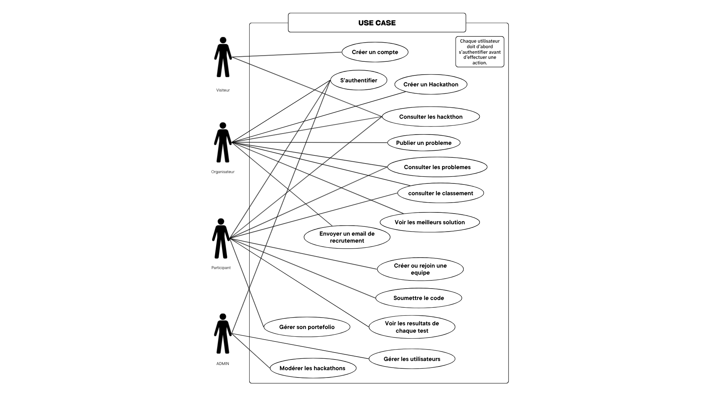

# Vue d'ensemble, acteurs et cas d'utilisation

## Contexte

Les entreprises ont des problèmes techniques qu'elles n'ont ni le temps ni les moyens de résoudre en interne, et elles peinent à évaluer le niveau réel des développeurs avec des CV et des entretiens. Les hackathons répondent aux deux besoins, mais la publication des problèmes, la correction, le classement et le suivi des candidats se font encore à la main (Google Forms, Excel, emails).

## Problèmes identifiés et solutions

| # | Problème | Solution apportée | Microservice |
| :--- | :--- | :--- | :--- |
| P1 | Correction manuelle du code | Exécution automatique sur chaque test | MS4 + MS5 |
| P2 | Évaluation subjective | Mêmes tests, limites et règles de score pour tous | MS3 + MS5 |
| P3 | Outils dispersés | Une seule plateforme | MS1 + MS2 |
| P4 | Classement tardif et opaque | Score recalculé à chaque exécution, classement en direct | MS6 |
| P5 | Aucune trace après l'événement | Portfolio : participations, rangs, badges, compétences | MS7 |
| P6 | Recrutement coûteux et peu fiable | Filtre top N ou résolveurs, présélection, email | MS6 + MS7 |
| P7 | Problèmes internes non résolus | Problème réel publié comme défi avec ses tests | MS3 + MS4 |

Solutions existantes (Codeforces, LeetCode, Devpost, HackerRank, Codility, Google Forms) : aucune ne relie inscription, correction automatique, classement et recrutement dans un événement d'équipe organisé par une entreprise.

## Parcours complet

1. L'entreprise publie son problème réel et ses tests (MS2, MS3).
2. Les participants forment une équipe et s'inscrivent (MS2).
3. Ils soumettent leur code Python ou Java (MS4).
4. Le code est exécuté sur chaque test, avec un pourcentage de réussite (MS5).
5. Le classement est mis à jour en direct (MS6).
6. L'entreprise consulte les meilleures solutions et recrute par email (MS4, MS7).

## Acteurs

| Acteur | Qui est-ce ? | Ce qu'il fait |
| :--- | :--- | :--- |
| Visiteur | Personne non connectée | Consulte les hackathons et portfolios publics, crée un compte |
| Participant | Étudiant ou développeur inscrit | Rejoint une équipe ou participe seul, soumet du code, consulte résultats et portfolio |
| Organisateur | Représentant d'une entreprise | Publie des problèmes avec leurs tests, valide les résultats, récupère les meilleures solutions, contacte des candidats |
| Administrateur | Gestionnaire de la plateforme | Valide les entreprises, gère les comptes, modère les hackathons |

Connexion et rôles (`PARTICIPANT`, `ORGANISATEUR`, `ADMIN`) gérés par Keycloak (jetons JWT). Chaque utilisateur doit s'authentifier avant d'effectuer une action.

## Diagramme de cas d'utilisation



## Besoins fonctionnels (user stories)

Le code entre crochets indique le microservice concerné.

### Organisateur

1. Créer un hackathon (titre, date, durée, taille max des équipes, prix). [MS2]
2. Ouvrir les inscriptions, lancer et clôturer le hackathon. [MS2]
3. Publier ses problèmes réels comme défis : énoncé, langages, limites de temps et mémoire, points. [MS3]
4. Ajouter des tests (input, output attendu, poids), publics ou cachés. [MS3]
5. Voir le classement en direct et valider les résultats finaux. [MS6]
6. Consulter le code des meilleures solutions de chaque problème. [MS4 → MS5]
7. Filtrer les candidats : top N, ou ceux qui ont résolu un problème précis. [MS7 → MS6]
8. Consulter les portfolios visibles par les recruteurs. [MS7]
9. Présélectionner un candidat et lui envoyer un email. [MS7]
10. Suivre ses candidatures (présélectionné, contacté). [MS7]

### Participant

1. Consulter les hackathons ouverts. [MS2]
2. Créer une équipe, inviter des membres, accepter une invitation. [MS2]
3. Inscrire son équipe (ou s'inscrire seul si le règlement le permet) en acceptant le règlement, qui précise si l'entreprise peut réutiliser les solutions. [MS2]
4. Lire les problèmes une fois le hackathon lancé. [MS3]
5. Soumettre son code (Python ou Java), enregistré immédiatement. [MS4]
6. Voir le verdict, le pourcentage et le résultat de chaque test. [MS5]
7. Voir le score et le rang de son équipe. [MS6]
8. Gérer son portfolio et sa visibilité auprès des recruteurs. [MS7]

### Administrateur et visiteur

1. L'administrateur valide les comptes entreprise et peut suspendre un compte. [MS1]
2. L'administrateur modère les hackathons. [MS2]
3. Le visiteur crée un compte [MS1], consulte les hackathons [MS2] et les portfolios publics [MS7].

## Règle d'évaluation du code (MS5)

1. Compiler le code (Java).
2. Exécuter le code pour chaque test, l'input étant donné sur l'entrée standard.
3. Comparer la sortie à l'output attendu.
4. Enregistrer un verdict par test et le pourcentage :

```
pourcentage = (somme des poids des tests réussis / somme des poids de tous les tests) × 100
points      = pourcentage × points du problème
```

Exemple : problème à 200 points, 3 tests réussis sur 4 (poids égaux) → 75 % → 150 points. Égalité au classement : l'équipe qui a atteint son score la première passe devant.

## Périmètre

| Inclus | Exclu (évolutions futures) |
| :--- | :--- |
| Problèmes réels formulés en entrée / sortie testables | Problèmes non testables automatiquement (design, interface, architecture) |
| Consultation du code des meilleures solutions par l'organisateur | Rémunération ou cession juridique des solutions |
| Python et Java | Autres langages (C++, JavaScript…) |
| Entrée standard / sortie standard | Problèmes interactifs ou avec fichiers |
| Tests publics et cachés, pondérés | Détection de plagiat |
| Classement par équipe, meilleure soumission par problème | Classement mondial multi-hackathons |
| Portfolio rempli après clôture et validation | Recommandation de hackathons par IA |
| Présélection et email de contact | Gestion complète du recrutement |
| Communication REST synchrone | Communication asynchrone par broker de messages |

## Glossaire

| Terme | Explication |
| :--- | :--- |
| Microservice | Petite application indépendante gérant une partie du métier, avec sa propre base |
| API Gateway | Porte d'entrée unique vers les services |
| Eureka | Annuaire des services, qui s'y enregistrent par nom |
| Config Server | Configuration centralisée |
| Keycloak | Comptes, connexion, rôles (JWT) |
| OpenFeign | Client REST déclaratif pour appeler un service par son nom logique |
| Circuit breaker | Coupe les appels vers un service en panne et renvoie une réponse de secours |
| Verdict | Résultat d'une exécution : Accepted, Wrong Answer, Timeout, Runtime Error, Compilation Error |
| Test caché | Test que le participant ne voit jamais, utilisé pour l'évaluation |
| Résolveur | Participant ou équipe ayant résolu un problème à 100 % |
