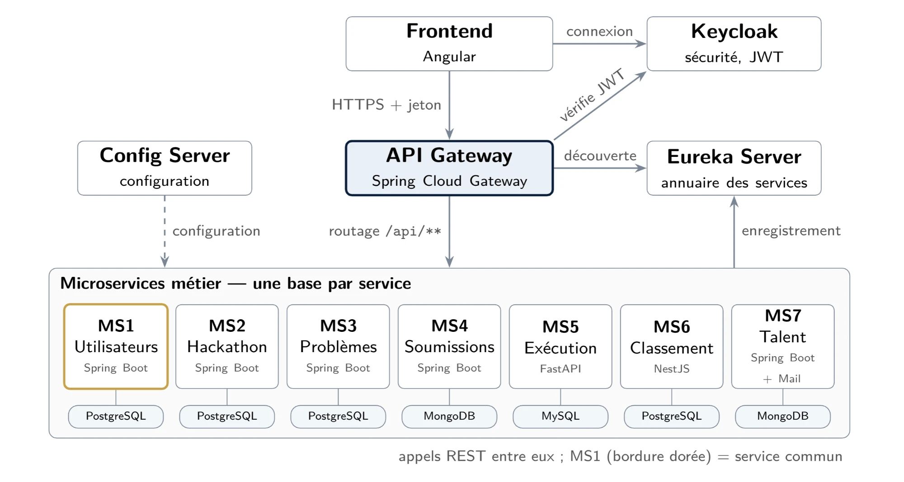
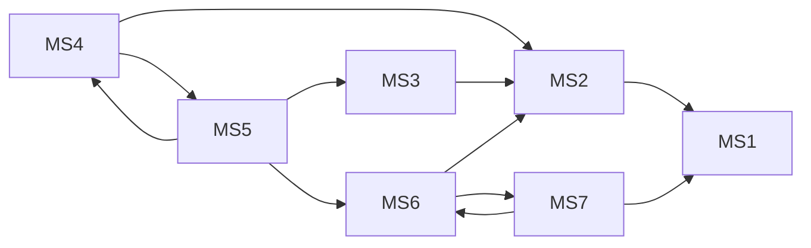

# Architecture technique

## Pourquoi des microservices

| Critère | Monolithe | Microservices (choix retenu) |
| :--- | :--- | :--- |
| Déploiement | Tout d'un coup | Service par service |
| Scalabilité | Duplication de toute l'application | Duplication du seul service chargé |
| Pannes | Une panne peut tout arrêter | Panne isolée : une soumission reste enregistrée |
| Technologies | Une seule | Java, Python ou TypeScript selon le besoin |
| Travail en équipe | Conflits sur le même code | Un étudiant par service |
| Maintenance | Code de plus en plus gros | Petits services faciles à comprendre |

## Architecture globale

Le frontend Angular ne parle qu'à l'**API Gateway** (HTTPS + jeton). La Gateway vérifie le jeton JWT auprès de **Keycloak**, trouve le bon service grâce à **Eureka** et route `/api/**`. Les services lisent leur configuration dans le **Config Server** et s'appellent entre eux en REST. MS5 (Exécution) n'est appelé que par MS4.

## Les 7 microservices

MS1 est commun (toute l'équipe) ; MS2 à MS7 sont individuels. Le découpage suit les capacités métier, pas les tables. **Une base par service**, aucune clé étrangère entre services : les identifiants d'autres services sont de simples valeurs.

| # | Microservice | Responsabilité | Technologie | Base | Resp. |
| :--- | :--- | :--- | :--- | :--- | :--- |
| MS1 | Utilisateurs (`utilisateur-service`) | Comptes, profils, rôles, lien Keycloak, validation des entreprises | Spring Boot 3 (Java 17) | PostgreSQL | Équipe |
| MS2 | Hackathon (`hackathon-service`) | Cycle de vie du hackathon, règlement, équipes, invitations, inscriptions | Spring Boot 3 (Java 17) | PostgreSQL | Étudiant 1 |
| MS3 | Problèmes (`probleme-service`) | Énoncés, tests, limites, points | Spring Boot 3 (Java 17) | PostgreSQL | Étudiant 2 |
| MS4 | Soumissions (`soumission-service`) | Enregistrer chaque soumission, éligibilité, historique, meilleures solutions | Spring Boot 3 (Java 17) | MongoDB | Étudiant 3 |
| MS5 | Exécution | Exécuter le code en environnement isolé, enregistrer le résultat | Python + FastAPI | MySQL | Étudiant 4 |
| MS6 | Classement | Score par problème, classement en direct, validation finale | NestJS (TypeScript) | PostgreSQL | Étudiant 5 |
| MS7 | Talent | Portfolio, badges, filtre des candidats, présélection, email | Spring Boot 3 + Spring Mail | MongoDB | Étudiant 6 |

Nommage Eureka en kebab-case (`hackathon-service`, `probleme-service`, `soumission-service`…).

### Justification des choix

- **PostgreSQL** (MS1, MS2, MS3, MS6) : données structurées, relations, transactions ; fonctions de classement SQL pour MS6.
- **MySQL** (MS5) : très nombreuses lignes simples (une par test exécuté), faciles à agréger.
- **MongoDB** (MS4, MS7) : documents à structure variable (code source ; portfolio avec participations imbriquées).
- **FastAPI** (MS5) : léger et rapide pour piloter l'exécution de programmes.
- **NestJS** (MS6) : structure modulaire adaptée à un service de calcul et d'exposition de classements.

### Carte des dépendances (« appelle »)

## Infrastructure et outils

| Couche | Technologie | Rôle |
| :--- | :--- | :--- |
| Frontend | Angular | Interface web, éditeur de code, classement |
| Point d'entrée | Spring Cloud Gateway | Routage et filtrage de toutes les requêtes |
| Découverte | Eureka Server | Annuaire des services |
| Configuration | Spring Cloud Config | Configuration centralisée |
| Sécurité | Keycloak (OAuth2 / JWT) | Comptes, connexion, rôles |
| Communication | OpenFeign + Resilience4j | Appels REST, circuit breaker |
| Documentation / supervision | springdoc-openapi, Actuator | Swagger UI, santé, métriques |
| Email | Spring Mail (SMTP) | Email de contact (MS7) |
| Gestion de projet | Git (GitHub), GitHub Projects ou Jira | Code et suivi |

## Services non Java

MS5 et MS6 n'utilisent pas Spring Cloud ; chacun a son équivalent.

| Besoin | Spring Boot | MS5 — FastAPI | MS6 — NestJS |
| :--- | :--- | :--- | :--- |
| Enregistrement Eureka | Eureka Client | `py-eureka-client` | `eureka-js-client` |
| Appels REST | OpenFeign | `httpx` | `@nestjs/axios` |
| Tolérance aux pannes | Resilience4j | timeouts + `tenacity` | `opossum` |
| Documentation API | springdoc-openapi | `/docs` (natif) | `@nestjs/swagger` |
| Supervision | Actuator | `/health` | `@nestjs/terminus` |
| Sécurité (JWT) | Spring Security (resource server) | `PyJWT` | `@nestjs/passport` + `passport-jwt` |
| Configuration | Spring Cloud Config | lecture HTTP du Config Server | lecture HTTP du Config Server |

## Besoins non fonctionnels

| Besoin | Mise en œuvre |
| :--- | :--- |
| Sécurité du code exécuté | Jamais dans un service métier ; MS5 isole : sans réseau, mémoire/CPU/temps limités, utilisateur sans privilèges |
| Authentification et rôles | Keycloak, jetons JWT vérifiés par la Gateway avant chaque requête |
| Confidentialité des tests | Tests cachés jamais envoyés au participant ; données entreprise anonymisées |
| Consentement | Visible des recruteurs et contacté uniquement avec son accord |
| Réutilisation des solutions | Règlement accepté à l'inscription ; seul l'organisateur voit le code |
| Disponibilité | Soumission toujours enregistrée ; timeouts, circuit breaker, reprise des soumissions en attente |
| Équité | Mêmes tests, limites et règles de score pour tous |
| Performance | Soumission enregistrée en < 1 s ; verdict simple en < 10 s |
| Observabilité | Actuator ou `/health` sur chaque service |
| Documentation | Swagger / OpenAPI par service |
| Autonomie | Projet, base et configuration propres ; lancement indépendant |

## Répartition et risques

| Tâche commune | Responsable |
| :--- | :--- |
| MS1 Utilisateurs | Toute l'équipe |
| Eureka, Config Server, API Gateway | À définir |
| Keycloak (rôles, clients) | À définir |
| Frontend Angular | Chacun fait les écrans de son service |
| README et lancement du système | À définir |

| Risque | Solution prévue |
| :--- | :--- |
| Exécution du code complexe (MS5) | Prototype testé ; plan B : Judge0 piloté par FastAPI |
| Code malveillant | Environnement isolé, sans réseau, avec limites |
| Attente longue de l'exécution | Réponse immédiate 202, interrogation régulière, limite de temps par test |
| Service indisponible | Timeouts, circuit breaker, reprise planifiée |
| Trois technologies back-end | Contrats Swagger fixés tôt, intégration régulière |
| Intégration de 7 services | Tests de bout en bout dès que deux services communiquent |
| Machines peu puissantes | Ne lancer que les services utiles en développement |
