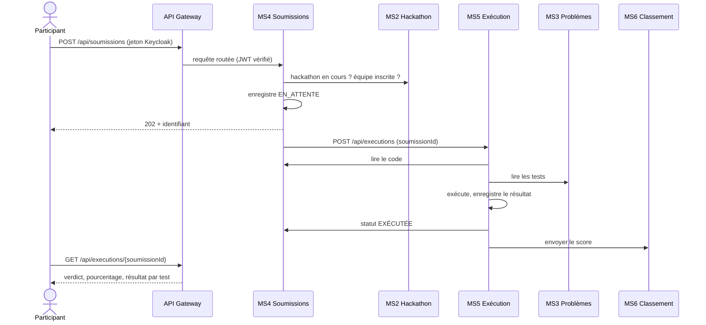

# Communication entre services

## Principe

Chaque microservice expose une API REST. Un service qui a besoin d'une donnée d'un autre l'appelle par son **nom logique enregistré dans Eureka** : OpenFeign pour les services Spring Boot (`@FeignClient(name = "hackathon-service")`), client HTTP pour FastAPI (`httpx`) et NestJS (`@nestjs/axios`). Toutes les communications sont synchrones (requête / réponse).

**Soumission rapide, exécution en arrière-plan** : MS4 enregistre la soumission et répond immédiatement (202). L'appel vers MS5 part ensuite sans bloquer le participant, et l'interface interroge régulièrement le résultat.

## Tableau des appels

| Appelant → appelé | Appel | Pourquoi | Si l'appelé est en panne |
| :--- | :--- | :--- | :--- |
| MS2 → MS1 | `GET /api/utilisateurs/{id}` | L'organisateur est-il une entreprise validée ? | Création refusée (503) |
| MS3 → MS2 | `GET /api/hackathons/{id}` | Le hackathon existe, l'organisateur en est propriétaire | Publication refusée (503) |
| MS4 → MS2 | `GET /api/hackathons/{id}`, `GET /api/inscriptions?equipeId=` | Hackathon en cours ? équipe inscrite ? | Soumission refusée (503) |
| MS4 → MS5 | `POST /api/executions` | Lancer l'exécution (soumissionId) | Soumission gardée EN_ATTENTE, relancée plus tard |
| MS5 → MS4 | `GET /api/soumissions/{id}`, `PATCH /api/soumissions/{id}/statut` | Lire le code et le langage ; mettre à jour le statut | Exécution reportée |
| MS5 → MS3 | `GET /api/problemes/{id}/tests` | Tests (publics et cachés), limites, points | Exécution reportée |
| MS5 → MS6 | `POST /api/classements/scores` | Pourcentage et points de l'équipe | Score « à transmettre », renvoyé plus tard |
| MS4 → MS5 | `GET /api/executions/meilleures?problemeId=` | Meilleurs résultats, pour les meilleures solutions | Message « indisponible » |
| MS6 → MS2 | `GET /api/hackathons/{id}` | L'utilisateur est l'organisateur (validation) | Validation refusée (503) |
| MS6 → MS7 | `POST /api/portfolios/participations` | Résultats validés à la clôture | Renvoi plus tard |
| MS7 → MS6 | `GET /api/classements/{id}[/resolveurs]` | Top N et résolveurs pour filtrer les candidats | Message « classement indisponible » |
| MS7 → MS1 | `GET /api/utilisateurs/{id}` | Nom et email du candidat | Données déjà copiées localement |

## Parcours d'une soumission

1. Le participant envoie `POST /api/soumissions` ; la Gateway vérifie le jeton.
2. MS4 vérifie auprès de MS2 que le hackathon est en cours (sinon **409**) et que l'équipe est inscrite (sinon **403**), puis enregistre la soumission : `EN_ATTENTE`.
3. MS4 répond **202** avec l'identifiant.
4. MS4 appelle MS5 avec cet identifiant, en arrière-plan.
5. MS5 lit le code (MS4) et les tests (MS3), exécute le code pour chaque input, compare les sorties et enregistre le résultat avec l'identifiant de la soumission.
6. MS5 met le statut à `EXÉCUTÉE` dans MS4 et envoie le score à MS6, qui garde la meilleure soumission et met à jour le classement.
7. Le participant lit son résultat (détail masqué pour les tests cachés).

## Gestion des pannes

- Chaque client a un **timeout** et une protection : circuit breaker Resilience4j (Spring Boot), nouvelles tentatives limitées (FastAPI : `tenacity`, NestJS : `opossum`).
- Aucune soumission non vérifiée n'est acceptée : si MS2 ne répond pas, MS4 renvoie **503** « réessayez dans un instant ».
- Si MS5 est indisponible, la soumission reste `EN_ATTENTE` ; une tâche planifiée de MS4 (`@Scheduled`) la relance.
- Si MS6 est indisponible, MS5 marque le score « à transmettre » et le renvoie par tâche planifiée.

## Exemple complet : « Green Coding Challenge »

Hackathon de 2 h, équipes de 3 maximum. Défi simplifié : additionner deux nombres, 4 tests.

| Test | Input | Attendu | Sortie du code | Résultat |
| :--- | :--- | :--- | :--- | :--- |
| 1 | `3 4` | 7 | 7 | Réussi |
| 2 | `10 20` | 30 | 30 | Réussi |
| 3 | `-5 5` | 0 | 10 | Échoué |
| 4 | `1000000 1` | 1000001 | 1000001 | Réussi |

3 tests sur 4 → 75 % → 150 points sur 200 → l'équipe passe 4e sur 20. À la clôture, l'organisateur valide, les portfolios sont mis à jour (MS6 → MS7), l'entreprise récupère le meilleur code (MS4) et contacte les résolveurs à 100 % (MS7).
