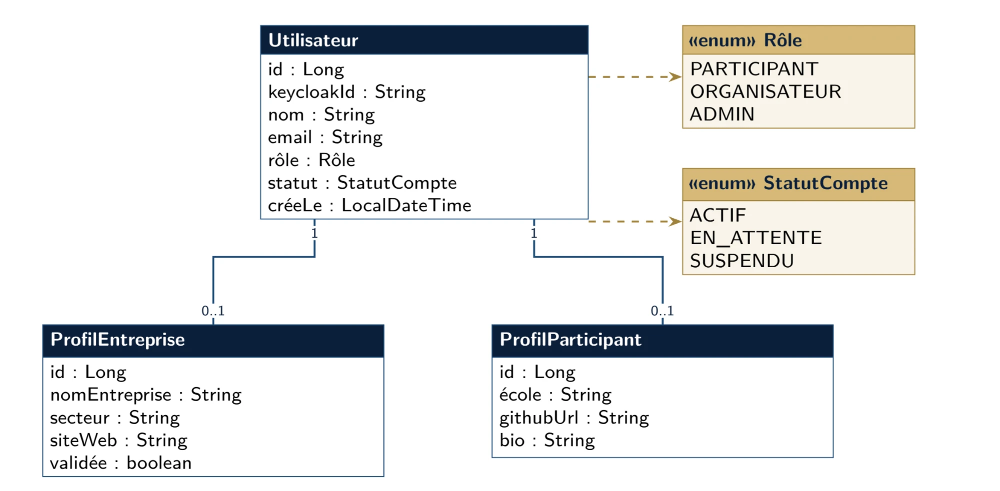
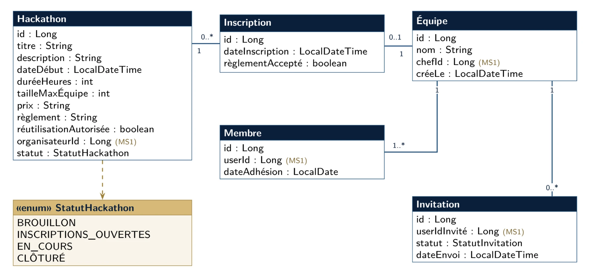
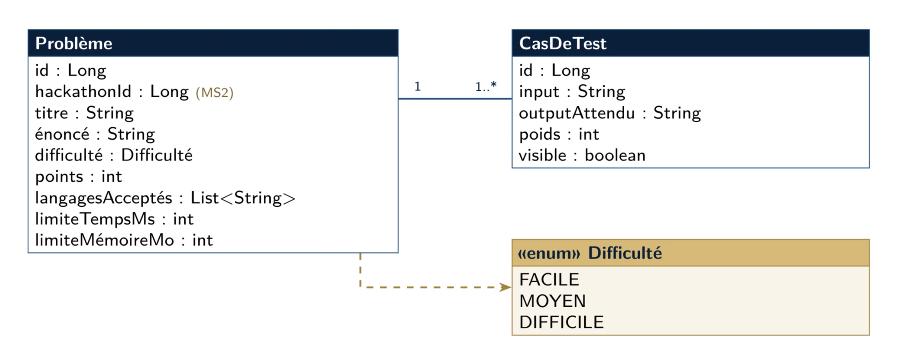
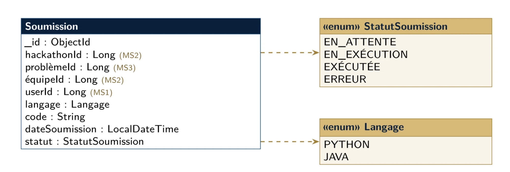
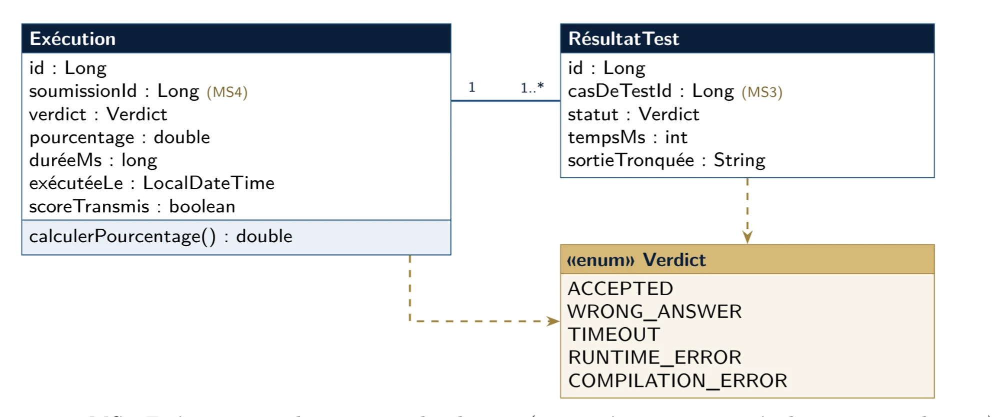
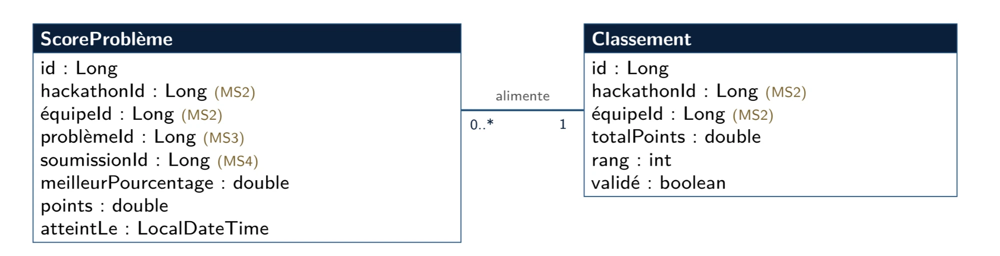
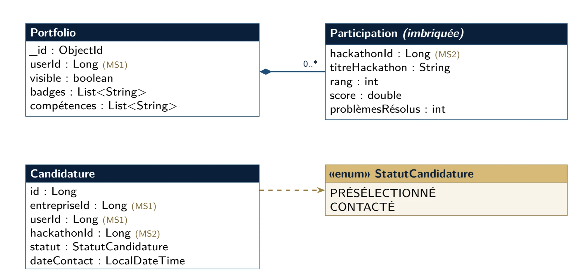

# Modèle de données

Un diagramme de classes par microservice, car chaque service a sa propre base. Les relations n'existent qu'à l'intérieur d'un service. Un identifiant venant d'un autre service est un simple attribut, noté `(MSx)`, jamais une clé étrangère.

## MS1 — Utilisateurs (PostgreSQL)

| Classe | Attributs |
| :--- | :--- |
| `Utilisateur` | id, keycloakId, nom, email, rôle (`Rôle`), statut (`StatutCompte`), créeLe |
| `ProfilEntreprise` (0..1) | id, nomEntreprise, secteur, siteWeb, validée |
| `ProfilParticipant` (0..1) | id, école, githubUrl, bio |

Énumérations : `Rôle` = PARTICIPANT, ORGANISATEUR, ADMIN · `StatutCompte` = ACTIF, EN_ATTENTE, SUSPENDU.

## MS2 — Hackathon (PostgreSQL)

| Classe | Attributs |
| :--- | :--- |
| `Hackathon` | id, titre, description, dateDébut, duréeHeures, tailleMaxÉquipe, prix, règlement, réutilisationAutorisée, organisateurId (MS1), statut |
| `Inscription` | id, dateInscription, règlementAccepté |
| `Équipe` | id, nom, chefId (MS1), créeLe |
| `Membre` | id, userId (MS1), dateAdhésion |
| `Invitation` | id, userIdInvité (MS1), statut, dateEnvoi |

Relations : Hackathon 1 — 0..* Inscription ; Inscription 0..1 — 1 Équipe ; Équipe 1 — 1..* Membre ; Équipe 1 — 0..* Invitation.
Énumérations : `StatutHackathon` = BROUILLON → INSCRIPTIONS_OUVERTES → EN_COURS → CLÔTURÉ · `StatutInvitation` = EN_ATTENTE, ACCEPTÉE, REFUSÉE.

## MS3 — Problèmes (PostgreSQL)

| Classe | Attributs |
| :--- | :--- |
| `Problème` | id, hackathonId (MS2), titre, énoncé, difficulté, points, langagesAcceptés, limiteTempsMs, limiteMémoireMo |
| `CasDeTest` | id, input, outputAttendu, poids, visible |

Un problème a 1..* cas de test. Énumération : `Difficulté` = FACILE, MOYEN, DIFFICILE.

## MS4 — Soumissions (MongoDB)

`Soumission` (un document par soumission) : _id, hackathonId (MS2), problèmeId (MS3), équipeId (MS2), userId (MS1), langage, code, dateSoumission, statut.
Énumérations : `StatutSoumission` = EN_ATTENTE, EN_EXÉCUTION, EXÉCUTÉE, ERREUR · `Langage` = PYTHON, JAVA.

## MS5 — Exécution (MySQL)

| Classe | Attributs |
| :--- | :--- |
| `Exécution` | id, soumissionId (MS4), verdict, pourcentage, duréeMs, exécutéeLe, scoreTransmis ; `calculerPourcentage()` |
| `RésultatTest` | id, casDeTestId (MS3), statut, tempsMs, sortieTronquée |

Une exécution a 1..* résultats de test. Énumération : `Verdict` = ACCEPTED, WRONG_ANSWER, TIMEOUT, RUNTIME_ERROR, COMPILATION_ERROR.

## MS6 — Classement (PostgreSQL)

| Classe | Attributs |
| :--- | :--- |
| `ScoreProblème` | id, hackathonId (MS2), équipeId (MS2), problèmeId (MS3), soumissionId (MS4), meilleurPourcentage, points, atteintLe |
| `Classement` | id, hackathonId (MS2), équipeId (MS2), totalPoints, rang, validé |

Les `ScoreProblème` (0..*) alimentent un `Classement`. Points = pourcentage × points du problème.

## MS7 — Talent (MongoDB)

| Classe | Attributs |
| :--- | :--- |
| `Portfolio` | _id, userId (MS1), visible, badges, compétences, participations[] |
| `Participation` (imbriquée) | hackathonId (MS2), titreHackathon, rang, score, problèmesRésolus |
| `Candidature` | id, entrepriseId (MS1), userId (MS1), hackathonId (MS2), statut, dateContact |

Énumération : `StatutCandidature` = PRÉSÉLECTIONNÉ, CONTACTÉ. Les participations sont imbriquées dans le portfolio (composition).

## Références inter-services

| Service | Identifiants externes stockés |
| :--- | :--- |
| MS2 | organisateurId, chefId, userId, userIdInvité → MS1 |
| MS3 | hackathonId → MS2 |
| MS4 | hackathonId, équipeId → MS2 ; problèmeId → MS3 ; userId → MS1 |
| MS5 | soumissionId → MS4 ; casDeTestId → MS3 |
| MS6 | hackathonId, équipeId → MS2 ; problèmeId → MS3 ; soumissionId → MS4 |
| MS7 | userId, entrepriseId → MS1 ; hackathonId → MS2 |
